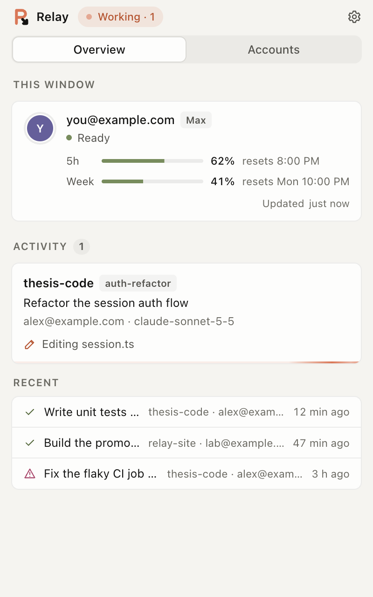
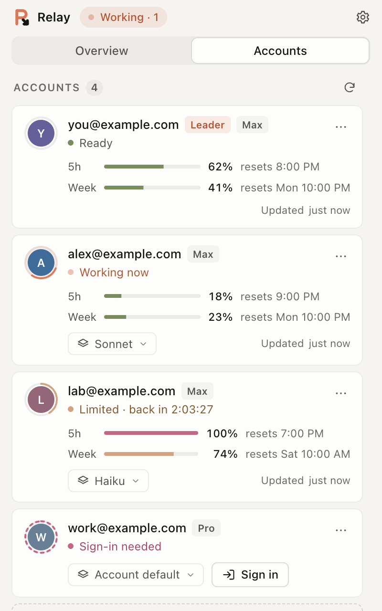
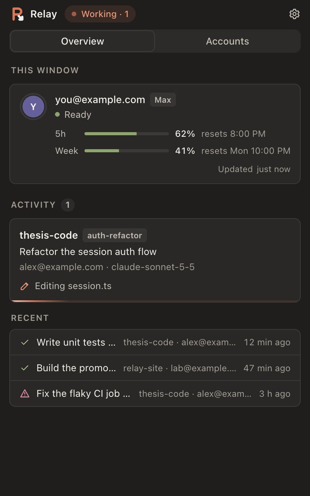
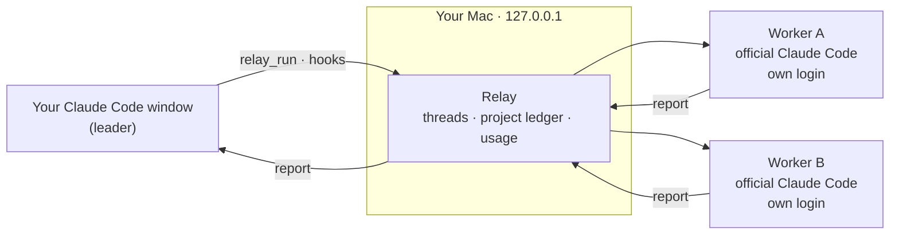

<div align="center">


# Relay

**One Claude Code window. Every Claude account you own.**

Your window plans and talks with you. Your other accounts do the heavy lifting.

[](LICENSE)
[](#install)
[](#install)
[](https://github.com/OvOhao/relay/actions/workflows/test.yml)

[Install](#install) · [Use it in a conversation](#use-it-in-a-conversation) · [How it works](#how-it-works) · [FAQ](#faq) · [中文](README.zh-CN.md)

</div>

<br>

<table>
<tr>
<td width="33%" align="center"><br><sub><b>Overview</b> · this window, live jobs, recent work</sub></td>
<td width="33%" align="center"><br><sub><b>Accounts</b> · 5-hour and weekly usage, a model each</sub></td>
<td width="33%" align="center"><br><sub><b>Dark mode</b> · follows macOS</sub></td>
</tr>
</table>

## Why

A Claude Code window runs on one account, and that account's usage runs out. Relay keeps your window as the **leader**: it talks with you, plans and reviews. Heavy, self-contained jobs go to your other accounts, the **workers**, each running the official Claude Code under its own login and its own usage. You keep one conversation; the work spreads across your plans.

## Features

| | |
|---|---|
| **Hand off** | Say `/relay <job>` or "use relay for this". A free worker takes it and the report comes back to your window. |
| **Memory** | A named thread resumes the same worker session, even after it moved to another account. A project ledger tells every worker what the others did. |
| **Usage at a glance** | Every account's 5-hour and weekly usage and when it resets, read from Claude Code's own `/usage`. |
| **A model per account** | Run mechanical jobs on Haiku and save the big models for the work that needs them. |
| **Safety net** | When the leader hits its limit mid-task, Relay resumes the same session on the next ready account in the background. |
| **Parallel, never clashing** | Different accounts work at once; one project folder is only ever written by one job, the rest queue. |
| **Native on macOS** | A menu-bar app: template icon, frosted panel under the icon, running-job count next to it, open at login. |
| **Local and private** | Everything listens on `127.0.0.1`. Relay never reads, copies or sends your credentials. |

## Install

You need [Claude Code](https://claude.com/claude-code) (the desktop app or the `claude` CLI) and Node.js 22 or newer.

```bash
git clone https://github.com/OvOhao/relay.git
cd relay
npm install
npm start
```

The **R** icon appears in the menu bar. Want to look around first, without touching your accounts?

```bash
npm start -- --demo
```

Build a real app (`Relay.app` and a `.dmg` for Apple silicon and Intel, written to `dist/`):

```bash
npm run dist:mac
```

The build is ad-hoc signed, not notarized. One you built yourself opens directly; a copied one needs **System Settings › Privacy & Security › Open Anyway** once, or `xattr -dr com.apple.quarantine /Applications/Relay.app`.

<details>
<summary><b>Windows</b></summary>

`npm start` runs it as a tray app; `npm run dist` builds an installer and a portable exe. The Windows code from Baton is kept, but the renamed build has not been re-tested on Windows.

</details>

## Set up

1. Click the menu-bar icon. **Accounts › Add account** for each Claude account you own; each one signs in once through Claude Code's own login, in a browser profile of its own.
2. **Connect.** Relay backs up `~/.claude/settings.json`, then adds two hooks (`StopFailure`, `SessionStart`), an MCP server `relay` and a skill `~/.claude/skills/relay`.
3. Start a **new** Claude Code session (open ones don't pick the tools up). `claude mcp list` should show `relay ✔ Connected`.

## Use it in a conversation

Just ask, in any new Claude Code session:

```text
/relay write unit tests for src/parser and make npm test pass
```

```text
Which relay accounts are free right now?
```

```text
Continue the auth-refactor thread: also handle expired sessions.
```

```text
Read the relay ledger for this project: what did the workers do?
```

Claude calls the tools for you:

| Tool | What it does |
|---|---|
| `relay_run` | Hands a job to a worker: `task`, `context`, `cwd`, an optional `thread` to continue, `read_only`, `account`, `model`, `title`. Returns the worker's report. |
| `relay_status` | Who is the leader, which workers are ready, how much usage each has left; the threads in a project. |
| `relay_ledger` | Everything workers did in a project, to get back on track after a long break or a compacted context. |

While a job runs, the number next to the menu-bar icon counts it and the panel shows which account is on it and what it is doing.

## How it works



- **Leader and workers.** The account of the window you are in is the leader; Relay recognises it from the session. Every other account is a worker.
- **Threads and the ledger.** Workers cannot see your conversation, so the leader writes a self-contained brief. A thread name resumes the same worker session; the project ledger goes into the next worker's prompt.
- **Usage.** Each account's numbers come from Claude Code's own `/usage`, read in the background and live while the panel is open.
- **Safety net.** A `StopFailure` hook notices a plan limit and Relay continues the session with `--resume` on the next ready account, then tells you.

## Privacy and safety

- Never reads, copies or sends your Claude credentials. Sign-in only through `claude auth login`; on macOS each login stays in the Keychain, managed by Claude Code.
- Local only: the panel, its API and the hooks listen on `127.0.0.1`. Nothing is proxied and the Claude Code binary is not modified.
- **Settings › Remove Relay** takes it all out again and restores your settings; saved sign-ins stay unless you tick the box.
- Use only accounts you own. Each account's limits and terms still apply: the [Consumer Terms](https://www.anthropic.com/legal/consumer-terms), the [Usage Policy](https://www.anthropic.com/legal/aup) and your organisation's terms for a Team or Enterprise seat.

## FAQ

<details>
<summary><b>An account keeps saying "Sign-in needed" right after I sign in</b></summary>

Another tool is deleting its login. On macOS Claude Code keeps one Keychain item per login folder; some multi-account tools (for example the `clauth` plugin) delete every such item they don't recognise whenever a Claude Code session starts. Relay shows a warning when it sees `clauth` enabled. Turn that tool off, then sign in again.

</details>

<details>
<summary><b>Coming from Baton?</b></summary>

On first start Relay moves `~/.baton` to `~/.relay`, except the sign-in folders under `~/.baton/accounts`, which stay where their logins are; nobody signs in again. A Claude Code connected as Baton is rewired as Relay and the old login agent is replaced. Quit Baton, then open a new Claude Code session.

</details>

<details>
<summary><b>Not verified yet</b></summary>

A real plan-limit takeover (tested with simulated limit events and a fake `claude`), Apple notarization, and the renamed build on Windows.

</details>

## Development

```bash
npm test                            # 76 tests against a fake claude: no usage spent
node src/dev.js --demo              # the panel in a browser
npx electron scripts/make-icon.js   # icons from build/logo.svg and build/mark.svg
npx electron scripts/screenshots.js # the screenshots above, from the demo
```

`src/core` holds accounts, limit detection and takeover, usage, project memory, workers, hooks and connect, macOS support and the Baton migration; `src/mcp.js` is the MCP server, `src/server.js` the local API, `ui/` the panel and `src/main.js` the Electron shell.

## Credits

Relay is a fork of **[Baton](https://github.com/zhenggao-30/baton)** by [ZhengGao-30](https://github.com/ZhengGao-30) and its [contributors](CONTRIBUTORS.md), reworked into a macOS menu-bar app. It is an independent project, not made by or affiliated with Anthropic.

[MIT](LICENSE)
