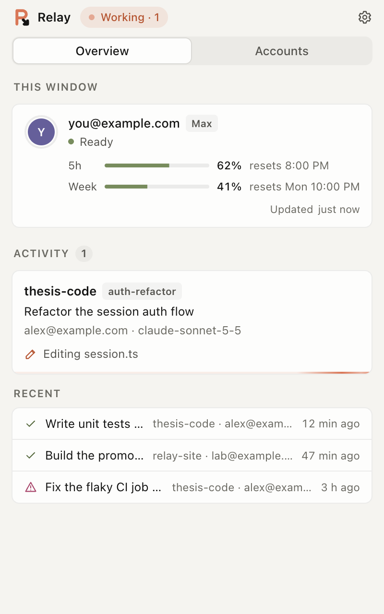
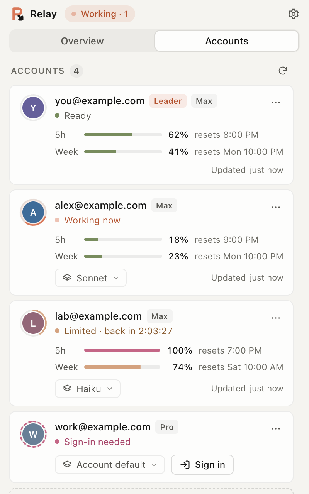
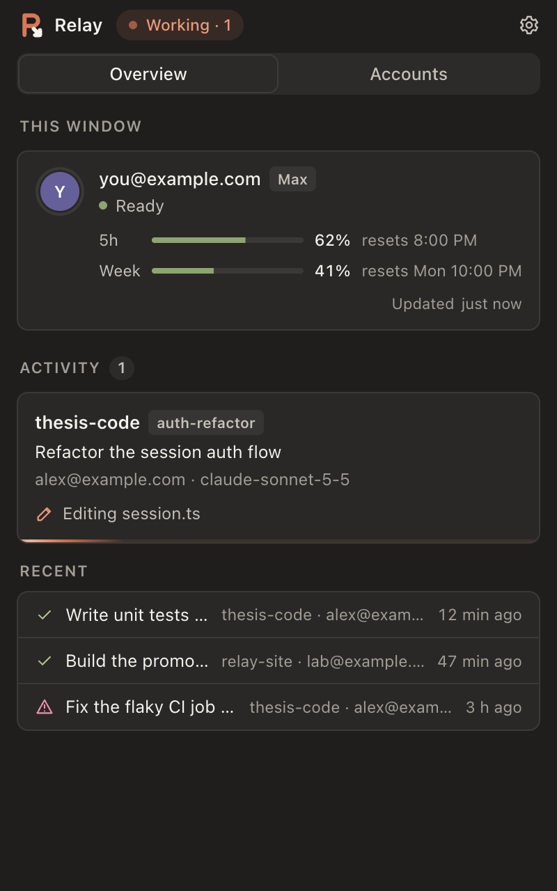
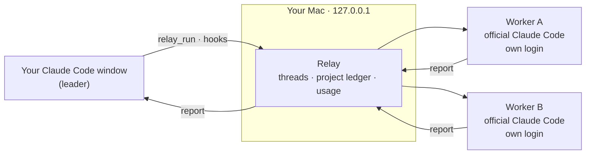

<div align="center">


# Relay

**One Claude Code window. Every Claude account you own.**

Your window plans and talks with you. Your other accounts do the heavy lifting.

[](LICENSE)
[](#install)
[](#install)
[](https://github.com/OvOhao/relay/actions/workflows/test.yml)

[Install](#install) · [Use it in a conversation](#use-it-in-a-conversation) · [How it works](#how-it-works) · [FAQ](#faq) · [中文](README.zh-CN.md)

</div>

<br>

<table>
<tr>
<td width="33%" align="center"><br><sub><b>Overview</b> · this window, live jobs, recent work</sub></td>
<td width="33%" align="center"><br><sub><b>Accounts</b> · 5-hour and weekly usage, a model each</sub></td>
<td width="33%" align="center"><br><sub><b>Dark mode</b> · follows macOS</sub></td>
</tr>
</table>

## Why

A Claude Code window runs on one account, and that account's usage runs out. Relay keeps your window as the **leader**: it talks with you, plans and reviews. Heavy, self-contained jobs go to your other accounts, the **workers**, each running the official Claude Code under its own login and its own usage. You keep one conversation; the work spreads across your plans.

## Features

| Feature | What it does |
|---|---|
| **Hand off** | Say `/relay <job>` or "use relay for this". A free worker takes it and the report comes back to your window. |
| **Memory** | A named thread resumes the same worker session, even after it moved to another account. A project ledger tells every worker what the others did. |
| **Usage at a glance** | Every account's 5-hour and weekly usage and when it resets, read from Claude Code's own `/usage`. |
| **A model per account** | Run mechanical jobs on Haiku and save the big models for the work that needs them. |
| **Safety net** | When the leader hits its limit mid-task, Relay resumes the same session on the next ready account in the background. |
| **Every worker at once** | Several jobs run in the same folder and conversation at the same time, one per free worker; with every worker busy, a job waits for the first one to come free. Jobs that name overlapping folders (`scope`) take turns, so they never edit the same files together. |
| **Long threads keep going** | When a thread's session nears its context limit (70% by default), or a call fails with "Prompt is too long", the old session writes a handoff note and the thread continues in a new session that starts from it. |
| **Worker health** | Relay checks that each worker can run the commands a project needs (`health_checks`) and has trusted the project folder, keeps jobs that need a refused command off that worker, and tells you the exact fix. |
| **Priorities** | `priority: "high"` jobs get the next free worker before normal and low ones; equal priorities go oldest first, across every window. |
| **Native on macOS** | A menu-bar app: template icon, frosted panel under the icon, running-job count next to it, open at login. |
| **Updates reach open windows** | Every tool call runs Relay's current code, so an update applies to conversations that are already open. |
| **Local and private** | Everything listens on `127.0.0.1`. Relay never reads, copies or sends your credentials. |

## Install

You need [Claude Code](https://claude.com/claude-code) (the desktop app or the `claude` CLI) and Node.js 22 or newer.

```bash
git clone https://github.com/OvOhao/relay.git
cd relay
npm install
npm start
```

The **R** icon appears in the menu bar. Want to look around first, without touching your accounts?

```bash
npm start -- --demo
```

Build a real app (`Relay.app` and a `.dmg` for Apple silicon and Intel, written to `dist/`):

```bash
npm run dist:mac
```

The build is ad-hoc signed, not notarized. One you built yourself opens directly; a copied one needs **System Settings › Privacy & Security › Open Anyway** once, or `xattr -dr com.apple.quarantine /Applications/Relay.app`.

<details>
<summary><b>Windows</b></summary>

`npm start` runs it as a tray app; `npm run dist` builds an installer and a portable exe. The Windows build is tested in CI but has not been tried on a real Windows machine yet.

</details>

## Set up

1. Click the menu-bar icon. **Accounts › Add account** for each Claude account you own; each one signs in once through Claude Code's own login, in a browser profile of its own.
2. **Connect.** Relay backs up `~/.claude/settings.json`, then adds two hooks (`StopFailure`, `SessionStart`), an MCP server `relay` and a skill `~/.claude/skills/relay`.
3. Start a **new** Claude Code session (open ones don't pick the tools up). `claude mcp list` should show `relay ✔ Connected`.

## Use it in a conversation

Just ask, in any new Claude Code session:

```text
/relay write unit tests for src/parser and make npm test pass
```

```text
Which relay accounts are free right now?
```

```text
Continue the auth-refactor thread: also handle expired sessions.
```

```text
Read the relay ledger for this project: what did the workers do?
```

Claude calls the tools for you:

| Tool | What it does |
|---|---|
| `relay_run` | Hands a job to a worker: `task`, `context`, `cwd`, an optional `thread` to continue, `read_only`, `account`, `model`, `effort` (low … max), `agent` (`claude` by default, or `codex`, see below), `title`, `scope` (the folders it changes), `preset` (a task preset, e.g. `security`), and path rules: `isolated` (an independent review: no project ledger, no other workers' results), `hide_paths` (paths it may not read), `write_paths` (the only paths it may change), `output_file` (+ `overwrite`: Relay saves the report there), `priority` (`high`, `normal` by default, `low`). Returns the worker's report. Call it several times in one turn to run jobs in parallel. |
| `relay_start` | Same parameters as `relay_run`, but returns at once with a job id; the job runs in the background (also if the window closes) and the leader keeps talking to you. Best for several jobs at once or long ones; `relay_run` is fine for one short job. |
| `relay_wait` | Waits for background jobs and returns as soon as any one finishes (or all, with `mode: "all"`), at most `timeout_sec` (default 300, max 600), with the finished jobs' full reports. A job that newly parks also returns, with its wake time (`include_parked: false` waits for real results only). |
| `relay_poll` | The state of background jobs (queued, waiting, running, parked, done, failed, cancelled), their priority (and place in line while waiting for a worker), context handoffs, with reports for finished ones and, for parked ones, the wake time, number of checks and latest report; or, given only `cwd`, the project's recent jobs. Finished jobs are kept for 7 days. |
| `relay_cancel` | Stops background jobs cleanly: the worker stops, its folder is freed, the ledger says cancelled. A parked job is cancelled without waking. |
| `relay_ack` | Records that the leader looked into flags Relay raised on jobs and resolved them: `job_ids`, `resolution` (required, e.g. *false positive: concurrent changes by other jobs, see job k3x9p2q1-4f7a*), optional `flags` (default: every flag still open on those jobs). Append-only, in the job record and the project ledger, with the window's account and the time. Resolved flags leave the **Needs action** line and the panel's warning badge but stay in `relay_poll` and `relay_status`, marked *resolved: …*. The same flag raised again by a later segment or wake needs action again. Worker sessions cannot ack. |
| `relay_wake` | Wakes parked jobs now for a progress check instead of at their scheduled time: `job_ids`, or `account` for every job parked on that worker. Each one resumes its own session through the normal wake path and starts its report with a one-line *Progress:*; the wake is marked *manual check* in the job's wake log, the short report goes into the job record (`relay_poll` / `relay_wait`) and a notification. The panel's **Check progress** button on a worker card does the same. Worker sessions cannot wake jobs. |
| `relay_status` | Who is the leader, which workers are ready, how much usage each has left, which worker is next in line and why, how many jobs each runs or has parked; background jobs with their priority and context handoffs; each worker's health (*health: 2 refused (ssh, latexmk), untrusted, checked 14:05*); the threads in a project and how full their context is. |
| `relay_health` | Checks the Claude workers (all, or one `account`) for the project at `cwd`: one tiny job each (Haiku, low effort, no file edits) runs every `health_checks` command and reports allowed / refused / exit code, and Relay reads whether the account has trusted the folder. Returns what is wrong and the exact fix; Relay never changes trust or permissions itself. |
| `relay_ledger` | Everything workers did in a project, to get back on track after a long break or a compacted context. |
| `relay_help` | The current parameters of every Relay tool, generated from Relay's own tool definitions. A conversation opened before a Relay update keeps the tool descriptions it started with (it does see new tools such as this one); the parameters `relay_help` lists work anyway, e.g. `isolated`, `output_file`, `hide_paths`, `write_paths`, `priority`. `relay_status` ends with a reminder of it. |

While a job runs, the number next to the menu-bar icon counts it and the panel shows which account is on it and what it is doing. Each account card says how many jobs it runs at once (*Working · 3 jobs*) with their titles, and its parked jobs (*Parked · wakes 15:30*).

**Long-running work: park and wake.** A worker that has launched something long (an experiment on a GPU server, a long build) and checked it really runs does not have to sit and watch it. It writes in its report what it launched, where the logs are and how to check, and ends with one line `RELAY_PARK: <minutes> | <what to check>`. The job is then *parked*: its account is free for other work at once. At that time (5 minutes to 24 hours later) the same session resumes on that account if it is ready, or on another ready one, with a scheduled check: finished → it collects and verifies the results and reports; nearly finished (about 15 minutes) → it stays and watches; otherwise → it reports progress and parks again (at most 48 checks per job). Each report is kept in the job record and the ledger. A `relay_run` whose worker parks returns at once with the report, the wake time and a job id, and carries on as a background job. A parked job wakes even if its background process died or the Mac restarted: the Relay app and every Relay tool call start a new one, and a wake time that passed while the Mac was off is caught up at once. You get a notification when a job parks and when it finishes.

**Which worker gets a job.** Jobs are spread out: every worker gets one job before any worker gets a second, two before any gets a third, and no worker runs more than 3 at once (*Jobs per worker at once* can lower that, never raise it). Each worker also gets its own cap from its weekly quota: *daily spare* = (100 − weekly % used) / days until its weekly reset (at least 0.25); 10 %/day or more → 3 jobs at once, 5 to 10 → 2, below 5 → 1, a week at 95% or more → 0 (it takes one only when every other worker is at its cap), usage unknown → 2. So an account at 86% that resets in 4.5 days runs 1 job while one at 81% that resets in 1.7 days runs up to 3. `relay_status` shows each worker's daily spare and cap, the panel's account card shows *Working · 2/3 jobs*. Among the workers that are ready and under their cap, Relay uses the one with the fewest running jobs (parked jobs do not count); among those with as many jobs, the lower **tier** first (each worker card has a tier selector 1 / 2 / 3, 1 = most preferred and the default: with a and b at tier 1 and c at tier 2, jobs go a, b, c, a, b, c), then within a tier an account whose 5-hour window is 95% used or more goes after the others, then the one whose weekly usage resets soonest (what is left of it is lost at the reset; unknown reset times after known ones), then the least recently used. The account a thread already runs on still comes first while it is under its cap; otherwise the thread moves to the next worker in that order. An `account` you name is used up to 3 jobs whatever its cap; when it is full, the job waits for a slot there. While Relay runs a project's `post_checks` after the worker has finished, the job shows *running checks* and its worker's slot is already free. When jobs wait because every worker is full, a freed slot goes to the highest `priority`, then the job that has waited longest, whichever window or background job tries first; a parked job keeps its priority when it wakes. In a project with `health_checks`, a job whose text names a command a worker refused at its last health check (or a worker that has not trusted the folder) goes to a healthy worker; if there is none it still runs, with a **HEALTH WARNING** in its header.

**Panel controls.** The leader's card has a switch **Leader takes jobs too**: off (the default), this window's account never gets a job; on, it is picked like any worker, with its own tier and cap (stored on the account in `accounts.json`; `relay_status` says which). **Dispatch** (Overview › Activity) starts a background job from the panel, exactly like `relay_start` (the same checks; a refusal shows in the dialog): task, project folder (picker and recent folders), optional thread, title, agent, model, effort, read-only, scope (required where the project has `require_scope` and the job may change files), priority, and *Run on* (Automatic, or a worker, or the leader when its switch is on). The job shows under Activity and any Claude window collects it with `relay_poll` (`cwd`). **Check progress** on a worker card wakes its parked jobs now (see `relay_wake`); a parked job past its wake time shows **WAKE OVERDUE**. Background jobs (`relay_start`, wakes, dispatched jobs) wait for a free worker or their folder as long as it takes and show their place in line; Settings › Jobs can cap that wait (`backgroundMaxWaitMin`), and only `relay_run` gives up with BUSY after 30 minutes. Settings › Scheduled wakes (macOS) keeps the Mac awake around wakes (`preventSleepForWakes`, `preventSleepMinutes`).

**Long threads: context handoff.** Relay notes how full each thread's session is after every run (the input of its last model call, against the model's context window when the stream reports it, else 200k; `contextWindow` in `~/.relay/settings.json`). Before the next call or wake of a thread at 70% or more (`handoffAt`), it first asks the old session for a handoff note (goal, decisions, state of files and runs, open issues, next step), saves it under `~/.relay/.relay-handoff/`, and starts a new session whose first prompt is that note plus the new task. A call that fails with the context-limit error is handed off the same way and run again; if the full session cannot even write a note, Relay builds one from the thread's stored reports and ledger entries. The thread record keeps the chain of session ids; `relay_poll` and `relay_status` show *handed off (n)*.

**Worker health.** List the commands your jobs depend on as `health_checks` in `.relay/project.json` (e.g. `bin/researchctl status`, `ssh -o BatchMode=yes gpu-box true`, `latexmk -v`). The tray app checks each Claude worker for such a project at most every 6 hours, `relay_health` and *Check health* in an account's menu check now. Each check is one tiny worker job that runs the commands with the permissions a real job gets; the account's workspace trust is read from its `.claude.json`. Results are kept in `~/.relay/health.json` and shown on the account card and in `relay_status`.

**Independent reviews, saved reports, limited writes.** `isolated: true` gives a worker no project ledger and no other worker's conclusions, so several reviewers stay independent; `hide_paths` (globs allowed) keeps it out of other reviews (Claude: Read deny rules plus Claude Code's bash sandbox, which refuses reads of those paths from shell commands too; Codex: deny paths in its permission profile), and if its tool calls touched them anyway the job is flagged **ISOLATION BREACH**. Isolated Claude jobs also run with auto memory and the git snapshot off, and cannot read `.git` or any account's memory folder. Claude jobs with `hide_paths` and all `isolated` Claude jobs run inside that sandbox, so they get no `ssh` or other direct network access (HTTP(S) still works) and can write only inside the job folder. `output_file` has Relay write the final report to a file itself, also for read-only and Codex jobs. `write_paths` lets a worker change files only under those paths: other edits are refused, and any change outside them fails the job with the list of files.

**Project rules: `.relay/project.json`.** In the job folder or a parent up to the git root: `rules_file` (appended to every worker's instructions, up to 20 KB), `protected_paths` (globs no job may change; a change fails the job with PROTECTED PATH CHANGED), `post_checks` (commands Relay runs after each job, per changed file with `{each:<glob>}`, `{file}`, `{idea}`; a failure flags the job **CHECKS_FAILED**), `health_checks` (commands the worker health check runs) `isolated_hide_paths` (added to `hide_paths` of every isolated job) and `require_scope: true` (a job that may change files must give `scope`, `write_paths` or `output_file`, or it is refused; a scope of `"."`, `cwd` or the git root is refused too). Failed and cancelled jobs are checked as well, and `relay_poll` / `relay_wait` / `relay_status` start with a **Needs action** line listing every flag to act on; `relay_ack` takes a flag off it once it is resolved. See [docs/project-config.md](docs/project-config.md).

**Structured summaries.** Every worker ends its report with a ```` ```relay-summary ```` JSON block (`status`, `run_ids`, `key_files`, `checks`, `decisions_needed`, `next_step`); Relay keeps it in the job record and the ledger, and `relay_poll` / `relay_wait` show it first.

**Models.** `model` takes `haiku`, `sonnet`, `opus` or `fable` (or a full id such as `claude-fable-5-1`); each account card can set its default model, and shows Fable's own weekly usage when the account has it.

## What workers may do

Workers run in the background, so nobody is there to approve a command. **Settings** decides what they may do:

- **Permission mode.** *Auto* works like your own window: routine commands run, risky ones are refused. *Edit files*, *Do everything* and *Read only* are there too.
- **Commands workers may run.** Claude Code permission rules such as `Bash(npm test)`.
- **Commands workers may never run.** Refused however the command is written: a full path, `./`, or inside `cd … && …`. Use it for what only you or your own window should do, such as `Bash(git push *)`.
- **Jobs.** *One job at a time per folder* (off by default) and *Jobs per worker at once* (1, 2 or 3; 3 for new installs, never more than 3). Several jobs on one account run as separate sessions side by side.
- **Task presets.** Background a worker gets in its system prompt for one kind of work, so it reads a legitimate task correctly. The built-in *Security research* preset is applied when the dispatcher asks for it (`preset: "security"`) or when a job mentions one of its keywords (vulnerability, exploit, prompt injection, red team, …). A preset with `projects` (absolute folders, set in `~/.relay/settings.json`) applies to every job in those folders. Write only what is true about your work: a preset gives context, it lifts no limit.

Relay writes these rules into each worker account's own `settings.json` (your settings plus the rules) and keeps them current. Your own `~/.claude/settings.json` is never changed.

### Codex workers (read-only)

A ChatGPT login of the OpenAI Codex CLI can be a worker too, for an independent second opinion from another model family. Codex workers take **read-only** jobs only (reviews, audits, investigation): `relay_run` with `agent: "codex"` and `read_only: true`; their report comes back like any other.

- Sign the Codex CLI in with its own home, then register it: `CODEX_HOME=~/.relay/codex/<name> codex login`, then `relay add-codex <name> ~/.relay/codex/<name> --model <id>` (a model is required: `codex` lists the ones your plan has). Relay never writes into, signs out of or deletes a Codex home.
- Every run is sandboxed read-only with a permission profile that denies your home folder (so `~/.ssh`, `~/.relay`, `~/.claude`, `~/.codex` and the Keychain cannot be read) and allows only the job folder and the Codex program. Plugins, apps, MCP servers and your `config.toml` are off.
- Before each run a check with no model call (`codex sandbox`) must show that a canary file under `~/.relay` cannot be read and the job folder can; otherwise the job is refused. After the run the job fails if any file in the folder changed, or if the session shows another sandbox profile.
- A thread stays on Codex; a limited Codex account hands the job to another Codex account (it starts again there: Codex sessions cannot move between accounts), never to a Claude one.

## How it works



- **Leader and workers.** The account of the window you are in is the leader; Relay recognises it from the session. Every other account is a worker.
- **Threads and the ledger.** Workers cannot see your conversation, so the leader writes a self-contained brief. A thread name resumes the same worker session; the project ledger goes into the next worker's prompt.
- **Usage.** Each account's numbers come from Claude Code's own `/usage`, read in the background and live while the panel is open.
- **Safety net.** A `StopFailure` hook notices a plan limit and Relay continues the session with `--resume` on the next ready account, then tells you.

## Privacy and safety

- Never reads, copies or sends your Claude credentials. Sign-in only through `claude auth login`; on macOS each login stays in the Keychain, managed by Claude Code.
- Local only: the panel, its API and the hooks listen on `127.0.0.1`. Nothing is proxied and the Claude Code binary is not modified.
- **Settings › Remove Relay** takes it all out again and restores your settings; saved sign-ins stay unless you tick the box.
- Use only accounts you own. Each account's limits and terms still apply: the [Consumer Terms](https://www.anthropic.com/legal/consumer-terms), the [Usage Policy](https://www.anthropic.com/legal/aup) and your organisation's terms for a Team or Enterprise seat.

## FAQ

<details>
<summary><b>An account keeps saying "Sign-in needed" right after I sign in</b></summary>

Another tool is deleting its login. On macOS Claude Code keeps one Keychain item per login folder; some multi-account tools (for example the `clauth` plugin) delete every such item they don't recognise whenever a Claude Code session starts. Relay shows a warning when it sees `clauth` enabled. Turn that tool off, then sign in again.

</details>

<details>
<summary><b>Not verified yet</b></summary>

A real plan-limit takeover (tested with simulated limit events and a fake `claude`), Apple notarization, and a real Windows machine.

</details>

## Development

```bash
npm test                            # 87 tests against a fake claude: no usage spent
node src/dev.js --demo              # the panel in a browser
npx electron scripts/make-icon.js   # icons from build/logo.svg and build/mark.svg
npx electron scripts/screenshots.js # the screenshots above, from the demo
```

`src/core` holds accounts, limit detection and takeover, usage, project memory, workers, hooks and connect, and macOS support; `src/mcp.js` is the MCP server, `src/server.js` the local API, `ui/` the panel and `src/main.js` the Electron shell.

## Credits

Relay includes code by [ZhengGao-30](https://github.com/ZhengGao-30), used under the MIT license. It is an independent project, not made by or affiliated with Anthropic.

[MIT](LICENSE)
