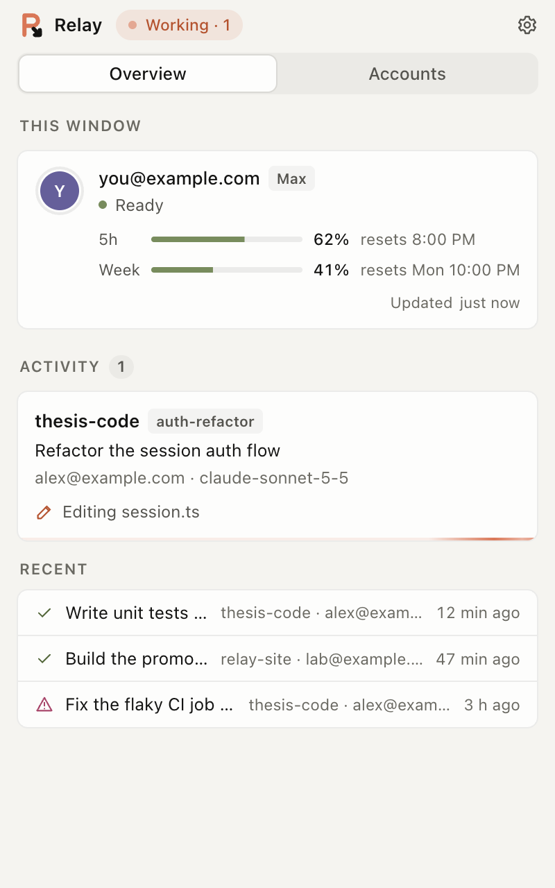
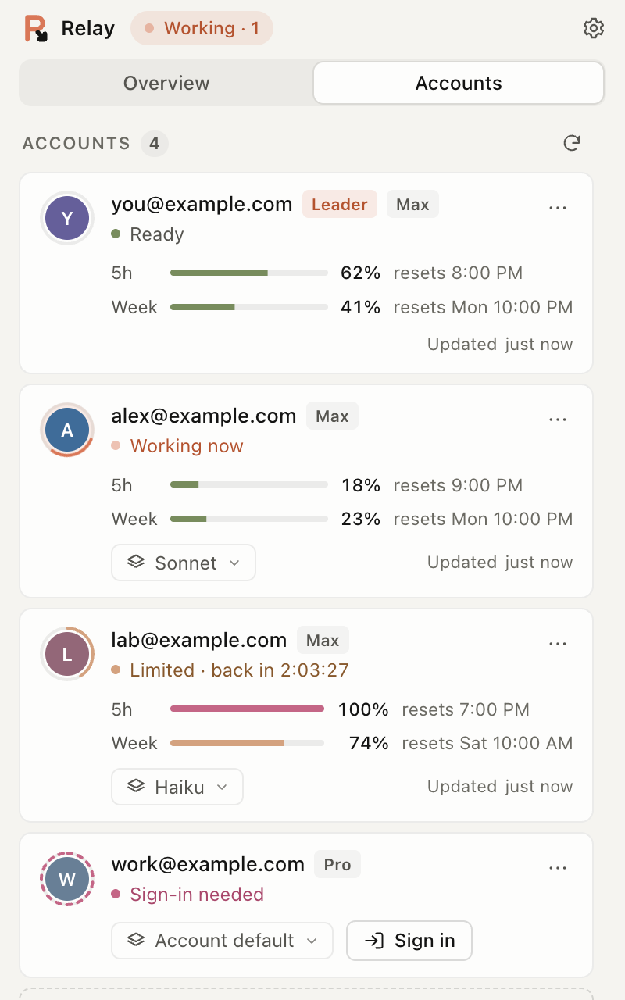
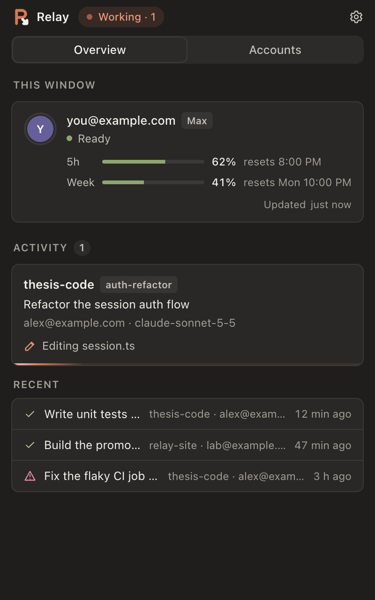
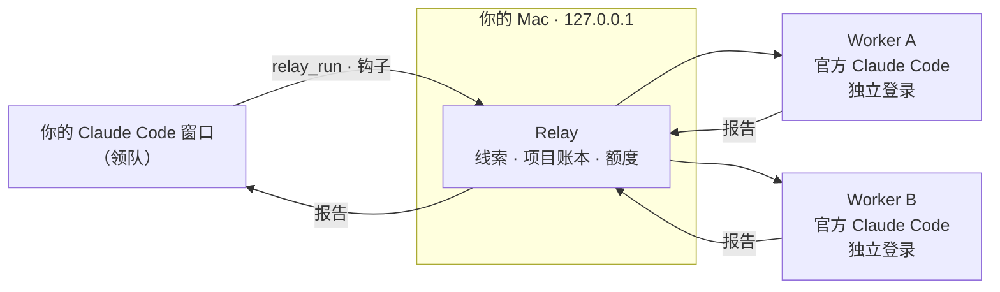

<div align="center">


# Relay

**一个 Claude Code 窗口，调用你拥有的每一个 Claude 账号。**

窗口负责和你对话、做规划，重活交给你的其他账号。

[](LICENSE)
[](#安装)
[](#安装)
[](https://github.com/OvOhao/relay/actions/workflows/test.yml)

[安装](#安装) · [在对话里使用](#在对话里使用) · [工作原理](#工作原理) · [常见问题](#常见问题) · [English](README.md)

</div>

<br>

<table>
<tr>
<td width="33%" align="center"><br><sub><b>概览</b> · 本窗口、实时任务、最近完成</sub></td>
<td width="33%" align="center"><br><sub><b>账号</b> · 5 小时 / 本周额度，每个账号一个模型</sub></td>
<td width="33%" align="center"><br><sub><b>深色模式</b> · 跟随 macOS</sub></td>
</tr>
</table>

## 为什么需要它

一个 Claude Code 窗口只用一个账号，这个账号的额度总会用完。Relay 让你的窗口当**领队**：和你对话、做规划、检查结果。大块、能独立完成的任务交给你的其他账号，也就是 **worker**。每个 worker 在自己的登录下运行官方 Claude Code，用的是它自己的额度。对话还是同一个，活分摊到了几个账号上。

## 功能

| 功能 | 说明 |
|---|---|
| **派发任务** | 说 `/relay <任务>` 或「用 relay 做这个」，空闲的 worker 接手，做完把报告交回你的窗口。 |
| **记忆** | 每条线索有名字，同一线索会接着同一个 worker 会话做，换了账号也不丢。项目账本记录每个 worker 做过什么。 |
| **额度一目了然** | 每个账号的 5 小时 / 本周用量和恢复时间，读自 Claude Code 自己的 `/usage`。 |
| **每个账号一个模型** | 机械活用 Haiku，大模型留给真正需要的任务。 |
| **安全网** | 领队任务做到一半撞上限额时，Relay 在后台换一个就绪的账号接着跑同一个会话。 |
| **所有 worker 一起干活** | 同一个文件夹、同一个对话里的多个任务可以同时运行，每个任务分给一个空闲的 worker；所有 worker 都在忙时，新任务等第一个空出来的。声明了重叠改动范围（`scope`）的任务会轮流执行，不会同时改同一批文件。 |
| **长线索不断档** | 某条线索的会话快用满上下文（默认 70%），或调用因「Prompt is too long」失败时，旧会话先写一份交接说明，线索在一个从这份说明开始的新会话里继续。 |
| **worker 健康检查** | Relay 检查每个 worker 能否运行项目需要的命令（`health_checks`）、是否信任了项目文件夹；需要某个被拒命令的任务不会派给那个 worker，并告诉你具体怎么修。 |
| **优先级** | `priority: "high"` 的任务比普通和低优先级的任务先拿到空出来的 worker；同一优先级先来先得，跨所有窗口。 |
| **macOS 原生体验** | 菜单栏应用：模板图标、从图标下方弹出的毛玻璃面板、图标旁显示运行中的任务数、开机启动。 |
| **更新对已开的对话立即生效** | 每次调用工具都会运行 Relay 的最新代码，所以 Relay 更新后，已经打开的对话也会直接用上。 |
| **本地、私密** | 只监听 `127.0.0.1`。Relay 从不读取、复制或发送你的登录凭证。 |

## 安装

需要先装好 [Claude Code](https://claude.com/claude-code)（桌面 App 或命令行 `claude` 都可以），以及 Node.js 22 以上。

```bash
git clone https://github.com/OvOhao/relay.git
cd relay
npm install
npm start
```

菜单栏里会出现 **R** 图标。想先看看效果、不碰真实账号：

```bash
npm start -- --demo
```

打包成正式应用（`Relay.app` 和 `.dmg`，Apple 芯片和 Intel 两种都有，在 `dist/` 里）：

```bash
npm run dist:mac
```

包是 ad-hoc 签名，没有经过 Apple 公证。自己构建的可以直接打开；从别处拷来的，第一次要到「系统设置 › 隐私与安全性」里点「仍要打开」，或者运行 `xattr -dr com.apple.quarantine /Applications/Relay.app`。

<details>
<summary><b>Windows</b></summary>

`npm start` 以托盘应用运行；`npm run dist` 打包安装程序和免安装版。Windows 版在 CI 里测试通过，但还没有在真实的 Windows 电脑上试过。

</details>

## 初次设置

1. 点菜单栏图标，在「账号 › 添加账号」里添加你拥有的每个 Claude 账号。每个账号走一次 Claude Code 自己的登录，并且用独立的浏览器配置，不会串号。
2. **连接**：Relay 先备份 `~/.claude/settings.json`，再加两条钩子（`StopFailure`、`SessionStart`）、一个 MCP 服务 `relay` 和一个技能 `~/.claude/skills/relay`。
3. **新开**一个 Claude Code 会话（已经开着的会话加载不到新工具）。运行 `claude mcp list`，能看到 `relay ✔ Connected` 就说明可以用了。

## 在对话里使用

在任意一个新开的 Claude Code 会话里直接说：

```text
/relay 给 src/parser 写单元测试，完成标准是 npm test 全部通过
```

```text
relay 现在有哪些账号空闲？
```

```text
继续 auth-refactor 那条线：再处理一下会话过期的情况。
```

```text
看一下这个项目的 relay 账本，之前 worker 都做了什么？
```

Claude 会替你调用这些工具：

| 工具 | 作用 |
|---|---|
| `relay_run` | 把任务交给 worker：`task`、`context`、`cwd`，可选的 `thread`（接着做）、`read_only`、`account`、`model`、`effort`（推理强度，low … max）、`agent`（默认 `claude`，也可以是 `codex`，见下文）、`title`、`scope`（它会改哪些文件夹）、`preset`（任务预设，例如 `security`），以及路径规则：`isolated`（独立评审：不给项目账本，看不到其他 worker 的结论）、`hide_paths`（不许读的路径）、`write_paths`（只许改的路径）、`output_file`（加 `overwrite`：由 Relay 把报告存到这个文件）、`priority`（`high`、默认 `normal`、`low`）。返回 worker 的报告。在同一轮里调用多次就能并行派活。 |
| `relay_start` | 参数和 `relay_run` 一样，但立即返回一个任务 id；任务在后台运行（窗口关掉也继续），领队可以继续和你对话。适合同时派多个任务或耗时长的任务；一个短任务用 `relay_run` 即可。 |
| `relay_wait` | 等待后台任务：任意一个完成就返回（`mode: "all"` 则等全部完成），最多等 `timeout_sec` 秒（默认 300，最多 600），附上已完成任务的完整报告。任务刚挂起时也会返回，并给出回来检查的时间（`include_parked: false` 则只等真正的结果）。 |
| `relay_poll` | 查看后台任务的状态（排队、等待、运行、已挂起、完成、失败、已取消）、优先级（等 worker 时还有排第几）、上下文交接次数，已完成的附报告，已挂起的附回来检查的时间、检查次数和最新报告；只给 `cwd` 时列出该项目最近的任务。完成的任务保留 7 天。 |
| `relay_cancel` | 干净地停止后台任务：worker 停下、文件夹释放、记录里写明已取消。已挂起的任务直接取消，不再唤醒。 |
| `relay_ack` | 领队核查并处理完 Relay 给任务打的标记后，用它记录下来：`job_ids`、`resolution`（必填，例如 *false positive: concurrent changes by other jobs, see job k3x9p2q1-4f7a*）、可选的 `flags`（默认是这些任务所有仍待处理的标记）。只追加不修改，写进任务记录和项目账本，附上当前窗口的账号和时间。已处理的标记不再出现在 **Needs action** 行和面板的警告标志里，但 `relay_poll` 和 `relay_status` 里仍然能看到，标为 *resolved: …*。同一个标记在之后的阶段或唤醒中再次出现，需要重新处理。worker 会话不能使用它。 |
| `relay_wake` | 立刻唤醒挂起的任务做一次进度检查，而不是等到预定时间：`job_ids`，或者 `account`（唤醒挂在这个 worker 上的所有任务）。每个任务按正常的唤醒流程续上自己的会话，报告第一行是一句 *Progress:*；这次唤醒在任务的唤醒记录里标为 *manual check*，简短报告写进任务记录（`relay_poll` / `relay_wait` 可见）并弹出通知。面板里 worker 卡片上的 **检查进度** 按钮做的是同一件事。worker 会话不能使用它。 |
| `relay_status` | 谁是领队、哪些 worker 就绪、各自还剩多少额度、下一个任务给谁及原因、每个 worker 正在跑和挂起的任务数；后台任务及其优先级和上下文交接次数；每个 worker 的健康状态（*health: 2 refused (ssh, latexmk), untrusted, checked 14:05*）；以及某个项目里的线索和它们的上下文用了多少。 |
| `relay_health` | 检查 `cwd` 所在项目的 Claude worker（全部，或指定 `account`）：每个账号跑一个很小的任务（Haiku、低推理强度、不改文件），逐条运行 `health_checks` 里的命令，报告允许 / 被拒 / 退出码；Relay 同时读取该账号是否信任了这个文件夹。返回问题和具体的修复方法；Relay 自己从不改信任或权限设置。 |
| `relay_ledger` | 某个项目里 worker 做过的所有事，适合隔了很久或上下文被压缩后重新接上。 |
| `relay_help` | 所有 Relay 工具当前的参数，直接从 Relay 自己的工具定义生成。Relay 更新前就打开的对话会保留它当初拿到的工具说明（新增的工具，比如这个，它能看到）；`relay_help` 列出的参数照样可以用，例如 `isolated`、`output_file`、`hide_paths`、`write_paths`、`priority`。`relay_status` 的末尾也会提示它。 |

任务运行时，菜单栏图标旁的数字会加一，面板里能看到是哪个账号在做、正在做哪一步。每张账号卡片会显示它同时在跑几个任务（「正在工作 · 3 个任务」）和这些任务的标题，以及它挂起的任务（「已挂起 · 15:30 回来检查」）。

**长时间任务：挂起与唤醒。** worker 启动了耗时很长的工作（比如在 GPU 服务器上跑实验、长时间编译），并确认它确实在运行后，不必守着。它在报告里写清楚启动了什么、日志和结果在哪、怎么查看状态，最后一行写 `RELAY_PARK: <分钟数> | <回来时检查什么>`。任务随即「挂起」，它的账号马上空出来给别的任务用。到时间（5 分钟到 24 小时后），同一个会话会接着在原账号上继续（原账号不可用时换另一个就绪的账号），做一次定时检查：已完成就收集、核对结果并写最终报告；大约 15 分钟内能完成就留下来盯到结束；否则汇报进度，重新估计时间再挂起（每个任务最多检查 48 次）。每段报告都保存在任务记录和项目账本里。`relay_run` 里的 worker 挂起时，会立即返回报告、唤醒时间和任务 id，之后作为后台任务继续。即使后台进程意外退出或 Mac 重启，挂起的任务也会按时唤醒：Relay 应用启动时和每次调用 Relay 工具时都会补上缺失的进程，关机期间错过的唤醒时间会立即补上。任务挂起和完成时都会弹出通知。

**独立评审、报告存档、限定写入。** `isolated: true` 时 worker 拿不到项目账本，也看不到其他 worker 的结论，多个评审互不影响；`hide_paths`（可用通配符）让它读不到其他评审（Claude：Read 拒绝规则，外加 Claude Code 的 bash 沙箱，shell 命令也读不到这些路径；Codex：权限配置里的拒绝路径），若它的工具调用仍然碰到了这些路径，任务会被标记 **ISOLATION BREACH**。隔离的 Claude 任务还会关掉 auto memory 和 git 快照，并且读不到 `.git` 和任何账号的 memory 文件夹。带 `hide_paths` 的 Claude 任务和所有 `isolated` 的 Claude 任务都在这个沙箱里运行，因此不能用 `ssh` 或其他直接网络连接（HTTP(S) 仍可用），也只能在任务文件夹里写文件。`output_file` 让 Relay 自己把最终报告写进文件，只读任务和 Codex 任务也可以。`write_paths` 让 worker 只能在这些路径下改文件：别处的修改会被拒绝，任何超出范围的改动都会让任务失败，并列出相关文件。

**项目规则：`.relay/project.json`。** 放在任务文件夹或其上级（直到 git 根目录）：`rules_file`（追加到每个 worker 的指令里，最多 20 KB）、`protected_paths`（任何任务都不许改的路径；被改动则任务失败，标记 PROTECTED PATH CHANGED）、`post_checks`（每个任务结束后 Relay 运行的命令，可用 `{each:<glob>}`、`{file}`、`{idea}` 按改动的文件逐个运行；失败时任务标记 **CHECKS_FAILED**）、`health_checks`（worker 健康检查要运行的命令）`isolated_hide_paths`（加到每个隔离任务的 `hide_paths` 里）和 `require_scope: true`（可能改文件的任务必须给出 `scope`、`write_paths` 或 `output_file`，否则直接拒绝；scope 写 `"."`、`cwd` 本身或 git 根目录也会被拒绝）。失败和取消的任务同样会跑检查；`relay_poll` / `relay_wait` / `relay_status` 的第一行是 **Needs action**，列出所有需要处理的标记；处理完的标记用 `relay_ack` 从这一行去掉。详见 [docs/project-config.md](docs/project-config.md)。

**结构化摘要。** 每个 worker 的报告末尾都有一个 ```` ```relay-summary ```` JSON 块（`status`、`run_ids`、`key_files`、`checks`、`decisions_needed`、`next_step`）；Relay 把它存进任务记录和项目账本，`relay_poll` / `relay_wait` 会先显示它。

**任务分给哪个 worker。** 任务会先分散开：每个 worker 都分到一个任务之后，才会有 worker 接第二个；每个都有两个之后，才会有 worker 接第三个；每个 worker 同时最多 3 个（「每个 worker 同时接几个任务」只能调低，不能超过 3）。每个 worker 还按自己的周额度有一个上限：*每天可用余量* =（100 − 本周已用 %）/ 距本周额度刷新的天数（至少按 0.25 天算）；每天 10% 及以上 → 同时最多 3 个，5 到 10 → 2 个，低于 5 → 1 个；本周已用 95% 及以上 → 0 个（只有其他 worker 都到了各自上限时才接 1 个）；额度未知 → 2 个。所以本周用了 86%、4.5 天后才刷新的账号只跑 1 个任务，用了 81%、1.7 天后就刷新的账号最多跑 3 个。`relay_status` 显示每个 worker 的每天可用余量和上限，面板的账号卡片显示 *正在工作 · 2/3 个任务*。在就绪且没到自己上限的 worker 里，Relay 先用当前正在跑的任务最少的那个（挂起的任务不算）；任务数一样时，5 小时额度已用 95% 以上的账号排在后面，然后是每周额度最先刷新的（刷新时没用完的额度就浪费了；不知道刷新时间的排在知道的后面），再然后是最久没用的。某条线索已经在用的账号，只要没到它自己的上限就仍然优先；否则线索按上面的顺序换到下一个 worker。你指定的 `account` 不受额度上限限制，最多 3 个；它满了的时候，任务会等那个账号空出位置。worker 做完之后 Relay 运行项目的 `post_checks` 期间，任务显示 *running checks*，它占的 worker 位置已经空出来了。所有 worker 都满了、任务在排队时，空出来的位置先给 `priority` 最高的任务，同一优先级给等得最久的，不管哪个窗口或后台任务先来抢；挂起的任务被唤醒时保持原来的优先级。在配置了 `health_checks` 的项目里，如果任务文字提到某个 worker 上次健康检查时被拒的命令（或该 worker 没有信任这个文件夹），任务会交给健康的 worker；一个都没有时照样运行，但任务标题下会有 **HEALTH WARNING**。

**档位和面板上的按钮。** 每个 worker 卡片上可以选 **档位** 1 / 2 / 3（1 最优先，默认 1）：正在跑的任务数一样时，档位小的先接。比如 a、b 是 1 档，c 是 2 档，任务依次给 a、b、c、a、b、c。主账号卡片上有开关 **主账号也接任务**：关闭（默认）时这个窗口的账号永远不接任务；打开后它像普通 worker 一样参与分配，有自己的档位和上限（存在 `accounts.json` 里这个账号的记录上，`relay_status` 会显示）。概览 › 动态里的 **派任务** 直接从面板开一个后台任务，和 `relay_start` 完全一样（同样的检查，被拒绝时原因显示在对话框里）：任务内容、项目文件夹（可选择或从最近的文件夹里挑）、可选的线程名、标题、agent、模型、思考强度、只读、scope（项目设了 `require_scope` 且任务会改文件时必填）、优先级，以及 *分配给*（自动分配、某个 worker，或开关打开时的主账号）。任务会出现在“动态”里，任何 Claude 窗口都能用 `relay_poll`（`cwd`）取回。worker 卡片上的 **检查进度** 立刻唤醒它挂起的任务（同 `relay_wake`）；超过唤醒时间还没醒的挂起任务显示 **唤醒超时**。后台任务（`relay_start`、唤醒、从面板派的任务）会一直排队等空闲的 worker 或文件夹，并显示排第几；设置 › 任务 里可以给这个等待设上限（`backgroundMaxWaitMin`），只有 `relay_run` 等满 30 分钟会返回 BUSY。设置 › 定时唤醒（macOS）可以在唤醒前后不让 Mac 睡眠（`preventSleepForWakes`、`preventSleepMinutes`）。

**长线索：上下文交接。** 每次运行后，Relay 记下这条线索的会话用了多少上下文（最后一次模型调用的输入量，对比模型的上下文窗口；输出流没给出窗口大小时按 200k 计，可在 `~/.relay/settings.json` 用 `contextWindow` 改）。线索达到 70%（`handoffAt`）后，下次调用或唤醒前，Relay 先请旧会话写一份交接说明（目标、已做的决定、文件和运行的状态、未解决的问题、下一步），存到 `~/.relay/.relay-handoff/`，再开一个新会话，第一条提示就是这份说明加上新任务。调用因上下文超限而失败时，也按同样方式交接并重新执行；如果旧会话已经满到连说明都写不出，Relay 就用这条线索保存的报告和账本记录拼一份。线索记录里保留会话 id 的链条；`relay_poll` 和 `relay_status` 显示 *handed off (n)*。

**worker 健康检查。** 在 `.relay/project.json` 的 `health_checks` 里列出任务依赖的命令（例如 `bin/researchctl status`、`ssh -o BatchMode=yes gpu-box true`、`latexmk -v`）。菜单栏应用对这类项目的每个 Claude worker 最多每 6 小时检查一次；`relay_health` 和账号菜单里的「检查健康状态」立即检查。每次检查是一个很小的 worker 任务，用真实任务同样的权限运行这些命令；账号的工作区信任从它的 `.claude.json` 读取。结果保存在 `~/.relay/health.json`，显示在账号卡片和 `relay_status` 里。

**模型。** `model` 可以是 `haiku`、`sonnet`、`opus` 或 `fable`（也可以是完整 ID，比如 `claude-fable-5-1`）；每张账号卡片可以设默认模型，账号有 Fable 单独的周额度时也会显示出来。

## Worker 能做什么

worker 在后台运行，没有人能点「批准」。所以它能做什么，由 **设置** 决定：

- **权限模式**：*auto* 和你自己的窗口一样，常规命令直接执行，有风险的操作会被拒绝。也可以选「修改文件」「完全放手」「只读」。
- **Worker 可以直接运行的命令**：Claude Code 的权限规则，比如 `Bash(npm test)`。
- **Worker 永远不能运行的命令**：不管命令怎么写都会被拒绝，包括完整路径、`./`、放在 `cd … && …` 里。适合放只该由你或你的窗口来做的事，比如 `Bash(git push *)`。
- **任务**：「同一文件夹一次只跑一个任务」（默认关）和「每个 worker 同时接几个任务」（1、2 或 3；新安装默认 3，最多 3）。同一个账号上的多个任务各自是独立的会话，同时运行。
- **任务预设**：针对某类工作，写进 worker 系统提示里的背景说明，让它正确理解正当的研究任务。内置的「Security research」预设会在 leader 指定（`preset: "security"`），或者任务里出现关键词（vulnerability、exploit、prompt injection、red team、漏洞、攻击等）时套用。带 `projects`（绝对路径，在 `~/.relay/settings.json` 里设置）的预设会套用到这些文件夹里的所有任务。只写关于你工作的真实情况：预设提供的是背景，不会解除任何限制。

Relay 会把这些规则写进每个 worker 账号自己的 `settings.json`（你的设置加上这些规则），并保持更新。你自己的 `~/.claude/settings.json` 不会被改动。

### Codex worker（只读）

OpenAI Codex CLI 的 ChatGPT 登录也可以当 worker，用另一个模型家族给出独立的第二意见。Codex worker 只接**只读**任务（审查、审计、调查）：调用 `relay_run` 时传 `agent: "codex"` 和 `read_only: true`，报告和其他 worker 一样返回。

- 先用独立的 home 登录 Codex CLI，再注册：`CODEX_HOME=~/.relay/codex/<名字> codex login`，然后 `relay add-codex <名字> ~/.relay/codex/<名字> --model <id>`（必须指定模型，可用模型因套餐而异）。Relay 不会往 Codex home 里写东西，也不会替它退出登录或删除它。
- 每次运行都在只读沙箱里，权限配置禁止读取你的 home 文件夹（`~/.ssh`、`~/.relay`、`~/.claude`、`~/.codex`、钥匙串都读不到），只放行任务文件夹和 Codex 程序本身。插件、apps、MCP 服务器和你的 `config.toml` 都不加载。
- 每次运行前先做一次不调用模型的检查（`codex sandbox`）：`~/.relay` 下的诱饵文件必须读不到，任务文件夹必须能读，否则拒绝这个任务。运行结束后，如果文件夹里有任何文件变化，或者会话记录显示用的是别的沙箱配置，任务记为失败。
- 线索一直留在 Codex 上；某个 Codex 账号到达限额时，任务只会交给另一个 Codex 账号（在那里重新开始，因为 Codex 会话不能跨账号移动），不会交给 Claude 账号。

## 工作原理



- **领队和 worker**：你当前窗口登录的账号是领队，Relay 从会话里自动识别；其他账号都是 worker。
- **线索和账本**：worker 看不到你的对话，所以领队要写一份完整、能独立执行的任务说明。同一个线索名会接着同一个 worker 会话做；项目账本会放进下一个 worker 的提示里。
- **额度**：每个账号的数字读自 Claude Code 自己的 `/usage`。平时在后台定期读，面板打开时实时刷新。
- **安全网**：`StopFailure` 钩子发现套餐限额后，Relay 用 `--resume` 在下一个就绪的账号上接着跑同一个会话，跑完通知你。

## 隐私与安全

- 从不读取、复制或发送你的 Claude 凭证。登录只走 `claude auth login`；在 macOS 上，每个登录由 Claude Code 存在钥匙串里。
- 只在本机运行：面板、接口和钩子都只监听 `127.0.0.1`。不代理任何 API 流量，也不修改 Claude Code 程序。
- 「设置 › 移除 Relay」会撤销所有改动并恢复你的设置；已保存的登录默认保留，勾选后才会删除。
- 只使用你自己拥有的账号。每个账号的额度和条款照常适用：[Consumer Terms](https://www.anthropic.com/legal/consumer-terms)、[Usage Policy](https://www.anthropic.com/legal/aup)，Team 或 Enterprise 席位还要遵守所在组织的条款。

## 常见问题

<details>
<summary><b>账号刚登录完，很快又显示「需要重新登录」</b></summary>

有别的工具在删它的登录。macOS 上 Claude Code 为每个登录文件夹在钥匙串里存一条令牌；有些多账号工具（比如 `clauth` 插件）会在每次启动 Claude Code 会话时，删掉所有它认不出来的这类条目。Relay 检测到 `clauth` 已启用时会在面板上提醒。停用那个工具，然后重新登录即可。

</details>

<details>
<summary><b>还没验证过的部分</b></summary>

真实的套餐限额接管（目前只用模拟的限额事件和假的 `claude` 测过）、Apple 公证，以及在真实 Windows 电脑上的运行。

</details>

## 开发

```bash
npm test                            # 87 个测试，用假的 claude，不消耗额度
node src/dev.js --demo              # 在浏览器里看面板
npx electron scripts/make-icon.js   # 从 build/logo.svg 和 build/mark.svg 生成图标
npx electron scripts/screenshots.js # 用 demo 数据生成上面的截图
```

`src/core`：账号、限额检测与接管、额度读取、项目记忆、worker、钩子与连接、macOS 适配。`src/mcp.js` 是 MCP 服务，`src/server.js` 是本地接口，`ui/` 是面板，`src/main.js` 是 Electron 外壳。

## 致谢

Relay 包含 [ZhengGao-30](https://github.com/ZhengGao-30) 的代码，按 MIT 许可使用。Relay 是独立项目，与 Anthropic 无关联。

[MIT](LICENSE)
