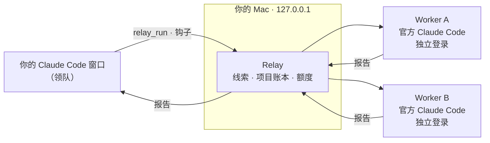

<div align="center">


# Relay

**一个 Claude Code 窗口，调用你拥有的每一个 Claude 账号。**

窗口负责和你对话、做规划，重活交给你的其他账号。

[](LICENSE)
[](#安装)
[](#安装)
[](https://github.com/OvOhao/relay/actions/workflows/test.yml)

[安装](#安装) · [在对话里使用](#在对话里使用) · [工作原理](#工作原理) · [常见问题](#常见问题) · [English](README.md)

</div>

<br>

<table>
<tr>
<td width="33%" align="center"><br><sub><b>概览</b> · 本窗口、实时任务、最近完成</sub></td>
<td width="33%" align="center"><br><sub><b>账号</b> · 5 小时 / 本周额度，每个账号一个模型</sub></td>
<td width="33%" align="center"><br><sub><b>深色模式</b> · 跟随 macOS</sub></td>
</tr>
</table>

## 为什么需要它

一个 Claude Code 窗口只用一个账号，这个账号的额度总会用完。Relay 让你的窗口当**领队**：和你对话、做规划、检查结果。大块、能独立完成的任务交给你的其他账号，也就是 **worker**。每个 worker 在自己的登录下运行官方 Claude Code，用的是它自己的额度。对话还是同一个，活分摊到了几个账号上。

## 功能

| 功能 | 说明 |
|---|---|
| **派发任务** | 说 `/relay <任务>` 或「用 relay 做这个」，空闲的 worker 接手，做完把报告交回你的窗口。 |
| **记忆** | 每条线索有名字，同一线索会接着同一个 worker 会话做，换了账号也不丢。项目账本记录每个 worker 做过什么。 |
| **额度一目了然** | 每个账号的 5 小时 / 本周用量和恢复时间，读自 Claude Code 自己的 `/usage`。 |
| **每个账号一个模型** | 机械活用 Haiku，大模型留给真正需要的任务。 |
| **安全网** | 领队任务做到一半撞上限额时，Relay 在后台换一个就绪的账号接着跑同一个会话。 |
| **并行不打架** | 不同账号可以同时干活；同一个项目文件夹同时只有一个任务在写，其他的排队。 |
| **macOS 原生体验** | 菜单栏应用：模板图标、从图标下方弹出的毛玻璃面板、图标旁显示运行中的任务数、开机启动。 |
| **本地、私密** | 只监听 `127.0.0.1`。Relay 从不读取、复制或发送你的登录凭证。 |

## 安装

需要先装好 [Claude Code](https://claude.com/claude-code)（桌面 App 或命令行 `claude` 都可以），以及 Node.js 22 以上。

```bash
git clone https://github.com/OvOhao/relay.git
cd relay
npm install
npm start
```

菜单栏里会出现 **R** 图标。想先看看效果、不碰真实账号：

```bash
npm start -- --demo
```

打包成正式应用（`Relay.app` 和 `.dmg`，Apple 芯片和 Intel 两种都有，在 `dist/` 里）：

```bash
npm run dist:mac
```

包是 ad-hoc 签名，没有经过 Apple 公证。自己构建的可以直接打开；从别处拷来的，第一次要到「系统设置 › 隐私与安全性」里点「仍要打开」，或者运行 `xattr -dr com.apple.quarantine /Applications/Relay.app`。

<details>
<summary><b>Windows</b></summary>

`npm start` 以托盘应用运行；`npm run dist` 打包安装程序和免安装版。Baton 原有的 Windows 代码都保留着，但改名后还没有在 Windows 上重新测试过。

</details>

## 初次设置

1. 点菜单栏图标，在「账号 › 添加账号」里添加你拥有的每个 Claude 账号。每个账号走一次 Claude Code 自己的登录，并且用独立的浏览器配置，不会串号。
2. **连接**：Relay 先备份 `~/.claude/settings.json`，再加两条钩子（`StopFailure`、`SessionStart`）、一个 MCP 服务 `relay` 和一个技能 `~/.claude/skills/relay`。
3. **新开**一个 Claude Code 会话（已经开着的会话加载不到新工具）。运行 `claude mcp list`，能看到 `relay ✔ Connected` 就说明可以用了。

## 在对话里使用

在任意一个新开的 Claude Code 会话里直接说：

```text
/relay 给 src/parser 写单元测试，完成标准是 npm test 全部通过
```

```text
relay 现在有哪些账号空闲？
```

```text
继续 auth-refactor 那条线：再处理一下会话过期的情况。
```

```text
看一下这个项目的 relay 账本，之前 worker 都做了什么？
```

Claude 会替你调用这些工具：

| 工具 | 作用 |
|---|---|
| `relay_run` | 把任务交给 worker：`task`、`context`、`cwd`，可选的 `thread`（接着做）、`read_only`、`account`、`model`、`title`。返回 worker 的报告。 |
| `relay_status` | 谁是领队、哪些 worker 就绪、各自还剩多少额度，以及某个项目里的线索。 |
| `relay_ledger` | 某个项目里 worker 做过的所有事，适合隔了很久或上下文被压缩后重新接上。 |

任务运行时，菜单栏图标旁的数字会加一，面板里能看到是哪个账号在做、正在做哪一步。

## 工作原理



- **领队和 worker**：你当前窗口登录的账号是领队，Relay 从会话里自动识别；其他账号都是 worker。
- **线索和账本**：worker 看不到你的对话，所以领队要写一份完整、能独立执行的任务说明。同一个线索名会接着同一个 worker 会话做；项目账本会放进下一个 worker 的提示里。
- **额度**：每个账号的数字读自 Claude Code 自己的 `/usage`。平时在后台定期读，面板打开时实时刷新。
- **安全网**：`StopFailure` 钩子发现套餐限额后，Relay 用 `--resume` 在下一个就绪的账号上接着跑同一个会话，跑完通知你。

## 隐私与安全

- 从不读取、复制或发送你的 Claude 凭证。登录只走 `claude auth login`；在 macOS 上，每个登录由 Claude Code 存在钥匙串里。
- 只在本机运行：面板、接口和钩子都只监听 `127.0.0.1`。不代理任何 API 流量，也不修改 Claude Code 程序。
- 「设置 › 移除 Relay」会撤销所有改动并恢复你的设置；已保存的登录默认保留，勾选后才会删除。
- 只使用你自己拥有的账号。每个账号的额度和条款照常适用：[Consumer Terms](https://www.anthropic.com/legal/consumer-terms)、[Usage Policy](https://www.anthropic.com/legal/aup)，Team 或 Enterprise 席位还要遵守所在组织的条款。

## 常见问题

<details>
<summary><b>账号刚登录完，很快又显示「需要重新登录」</b></summary>

有别的工具在删它的登录。macOS 上 Claude Code 为每个登录文件夹在钥匙串里存一条令牌；有些多账号工具（比如 `clauth` 插件）会在每次启动 Claude Code 会话时，删掉所有它认不出来的这类条目。Relay 检测到 `clauth` 已启用时会在面板上提醒。停用那个工具，然后重新登录即可。

</details>

<details>
<summary><b>之前用的是 Baton？</b></summary>

Relay 第一次启动时会把 `~/.baton` 迁到 `~/.relay`，但 `~/.baton/accounts` 下的登录文件夹原地保留（登录信息跟这个路径绑定），所以不用重新登录。如果之前以 Baton 的名字连接过 Claude Code，会自动换成 Relay，旧的开机启动项也会被替换。迁移后退出 Baton，新开一个 Claude Code 会话即可。

</details>

<details>
<summary><b>还没验证过的部分</b></summary>

真实的套餐限额接管（目前只用模拟的限额事件和假的 `claude` 测过）、Apple 公证，以及改名后的 Windows 版本。

</details>

## 开发

```bash
npm test                            # 76 个测试，用假的 claude，不消耗额度
node src/dev.js --demo              # 在浏览器里看面板
npx electron scripts/make-icon.js   # 从 build/logo.svg 和 build/mark.svg 生成图标
npx electron scripts/screenshots.js # 用 demo 数据生成上面的截图
```

`src/core`：账号、限额检测与接管、额度读取、项目记忆、worker、钩子与连接、macOS 适配、Baton 迁移。`src/mcp.js` 是 MCP 服务，`src/server.js` 是本地接口，`ui/` 是面板，`src/main.js` 是 Electron 外壳。

## 致谢

Relay 基于 [ZhengGao-30](https://github.com/ZhengGao-30) 和[贡献者们](CONTRIBUTORS.md)的 **[Baton](https://github.com/zhenggao-30/baton)** 修改而来，改成了 macOS 菜单栏应用。Relay 是独立项目，与 Anthropic 无关联。

[MIT](LICENSE)
